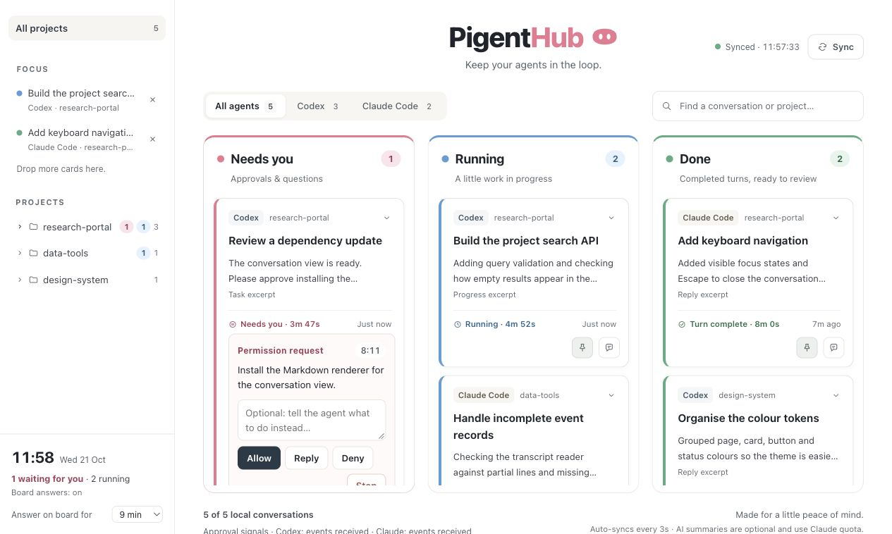
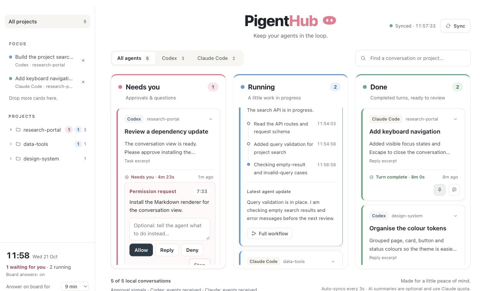
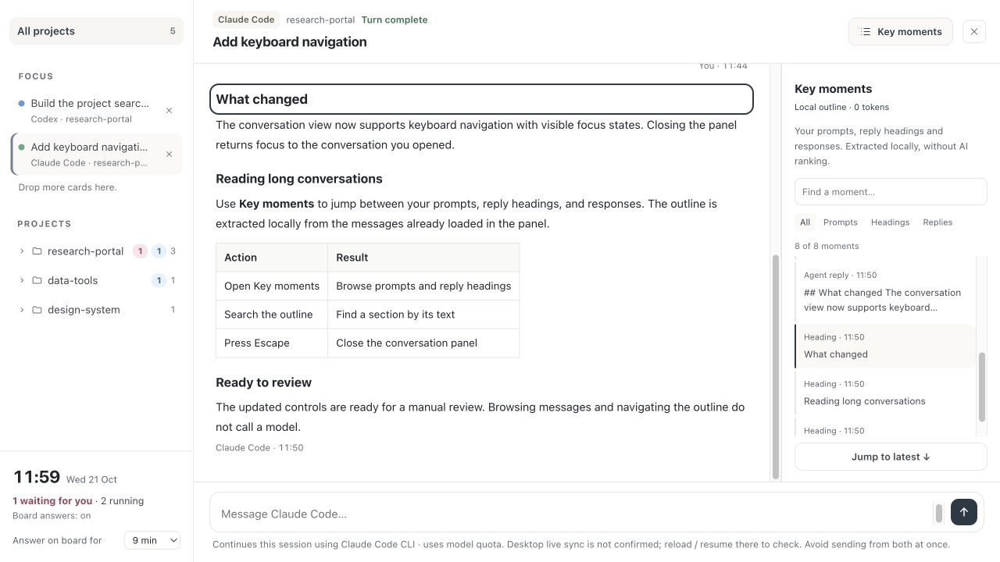

# PigentHub

**Keep track of your AI coding sessions in one place.**

PigentHub is a local dashboard for Codex and Claude Code. Browse conversations across projects, follow recent progress, and see which sessions need your attention from a single browser window.

When you have several coding sessions open, checking each one for updates becomes another task. PigentHub brings their latest replies, recent activity, and approval signals together so you can decide where to focus next.

## Preview



A shared view of Codex and Claude Code sessions, grouped by the attention they need. The screenshots use fictional projects and conversations rendered with the actual dashboard interface.

<details>
<summary>See recent progress and conversation navigation</summary>

### Follow recent progress

Expand a card to see recorded steps and the latest agent update while keeping the rest of the board in view.



### Navigate a conversation

Read the message history alongside Key moments, a searchable outline of prompts, reply headings, and responses extracted locally without model calls.



</details>

[Quick start](#quick-start) · [Approvals and messages](#enable-approvals-and-queued-messages) · [Privacy and usage](#privacy-and-model-usage) · [Troubleshooting](#troubleshooting) · [Technical notes](docs/technical-notes.md)

## Features

- **One board for two agents.** View local Codex and Claude Code conversations together, or filter by agent.
- **A clear overview of activity.** See sessions grouped into Needs you, Running, and Done, with a separate area for unconfirmed or interrupted activity. The board refreshes every three seconds.
- **Projects and Focus.** Browse conversations by project, search titles and reply previews, and pin individual sessions to Focus.
- **Readable conversation history.** Expand a card for recent progress, or open its conversation view to read messages and workflow details. Use Key moments to jump between prompts, replies, and headings.
- **Optional AI summaries.** Request a summary of a long reply and reuse the cached result when you return.
- **Actions from the board.** With the required CLI and hook setup, continue a conversation, queue a follow-up, or respond to supported approval requests and questions.
- **Return to your agent.** Open a conversation in its desktop app when the installed app supports the link, or copy the session ID.

## Requirements

- **Python 3.10 or later**, with `venv` and `pip` available.
- A local Codex or Claude Code installation with saved conversation records. You can use either agent on its own.
- A web browser.
- An internet connection for the first dependency installation.

Reading saved conversations does not require an API key or a model call. Sending messages requires the corresponding agent CLI to be available and authenticated. AI summaries require an authenticated Claude Code CLI, including when summarising a Codex reply.

Launchers are provided for macOS, Linux, and Windows. Desktop links and hook behaviour also depend on the installed agent version and operating system.

## Quick start

Clone the repository, then enter its folder:

```bash
git clone https://github.com/MengjiaoNan/pigenthub.git
cd pigenthub
```

You can also download the source archive from the repository's Code menu and extract it. Run the commands below from the folder containing `launcher.py` and `requirements.txt`.

### Start the dashboard

| Platform | Start | Stop |
| --- | --- | --- |
| macOS | Run `bash ./start-board.sh`, or double-click `启动看板.command` | Run `bash ./stop-board.sh`, or double-click `停止看板.command` |
| Linux | Run `bash ./start-board.sh` | Run `bash ./stop-board.sh` |
| Windows | Double-click `start-board.bat` | Double-click `stop-board.bat` |

Run terminal commands from the project folder. The launcher creates a local `.venv`, installs the Python dependencies when needed, starts the server, and opens your browser.

The default address is **[http://127.0.0.1:8001/](http://127.0.0.1:8001/)**. If that port is occupied, the launcher tries ports 8002 through 8010. Use the address it opens or prints.

You can also start and stop the dashboard directly:

```bash
# macOS / Linux
python3 launcher.py
python3 launcher.py stop
```

```powershell
# Windows
py -3 launcher.py
py -3 launcher.py stop
```

Add `--no-browser` to the start command to print the address without opening a browser.

The server continues running after you close the browser or startup terminal. Use a stop command or launcher to shut it down. Start it again after restarting your computer.

### Explore your sessions

1. Select a project in the sidebar, or keep All projects selected to see all sessions.
2. Use the agent filters and search field to narrow the board. Search matches conversation titles, project paths, and reply previews.
3. Click a card to expand its recent activity. Use its conversation button to open the message history and workflow details.
4. Open Key moments to navigate prompts, replies, and Markdown headings. Use the Load earlier messages button, when available, to include older history.
5. Add sessions you want to revisit to Focus.

Conversation text retains its original language. Key moments builds an outline from the loaded messages without calling a model.

## Enable approvals and queued messages

You can browse saved conversations before installing hooks. To receive supported approval signals, answer requests, and deliver messages queued during an active turn, configure the hooks for the agent you use.

After starting the dashboard once, preview the configuration:

```bash
# macOS / Linux
.venv/bin/python install_observers.py --source codex
```

```powershell
# Windows PowerShell
.\.venv\Scripts\python.exe install_observers.py --source codex
```

Review the generated configuration in `.board/`, then install it:

```bash
# macOS / Linux
.venv/bin/python install_observers.py --source codex --install
```

```powershell
# Windows PowerShell
.\.venv\Scripts\python.exe install_observers.py --source codex --install
```

Replace `codex` with `claude` for Claude Code, or `both` for both agents in the preview and installation commands.

The installer merges PigentHub's handlers into the selected agent's user configuration, preserves other handlers and settings, and backs up existing configuration files under `.board/hook-backups/`.

For Codex, review and trust the added hooks through `/hooks` in the Codex CLI, then reopen the session. Reopen existing Claude Code sessions so they can load the updated configuration. The launcher does not install or trust hooks automatically. If you move the project, reinstall the hooks to update their script paths.

Supported requests appear under Needs you. You can respond while the request is active; if no response arrives before the configured timeout, control returns to the agent's own interface. Adjust the wait time in the dashboard settings.

For Codex, this is a sequential handoff: its native approval prompt waits until the board's synchronous hook finishes. The current integration does not support answering the same approval concurrently in both interfaces. After handoff, the board keeps a non-actionable reminder until a corresponding tool result or turn-ending event arrives; an answer in the app may therefore take time to clear from the board.

## Send a follow-up

Open a conversation and use its message composer.

- **Idle sessions:** PigentHub starts the corresponding agent CLI to resume the existing session. Replies appear as the local conversation records update.
- **Active sessions:** The message enters a local queue and waits for a supported hook in that session to collect it. Delivery hooks must be configured. You can cancel a message while it remains queued.

A message marked as handed to a hook has been collected by the hook; the agent may still need to process it. The original desktop window may require a reload or session resume to show updated records. Send from one interface at a time to avoid concurrent continuations of the same session.

## Privacy and model usage

PigentHub serves the dashboard on your own machine and reads local conversation files. It does not edit the source transcript files directly. When you send a message, the agent CLI may append to those records as part of its normal operation.

| Action | Model usage |
| --- | --- |
| Refresh the board, search, read history, or use Key moments | No model calls |
| Generate or retry an AI summary | Sends the selected reply to Claude Code and uses your Claude account quota |
| View an already cached summary | No additional model call |
| Send a message or let an agent continue after your response | Uses the corresponding agent's normal model quota |

Summaries are generated only when you request them. They currently use the Claude Code `haiku` model alias and produce **Chinese text**. The full original reply remains available. The model can be changed with `BOARD_SUMMARY_MODEL`.

Local settings, queued messages, hook events, and summary caches are stored under `.board/`. Share source files when distributing the project; keep your conversation exports, `.board/`, and `.venv/` private. These generated files and folders are covered by the project's `.gitignore`.

## Current limitations

- Status reflects available local records and hook events. Activity can be delayed or incomplete. Done means the latest recorded turn has finished; the broader project may still have work remaining.
- Approval handling and queued-message delivery depend on hooks being loaded and, where required, trusted. Some prompts and cloud workflows do not emit supported local events.
- Desktop conversation links depend on installed app support. You can copy the session ID if a link is unavailable.
- The scanner currently covers local conversations, excluding recognised subagent sessions and Codex archived or cloud sessions.
- Windows and WSL have separate environments. Run PigentHub alongside the agent in the same environment, or configure shared data paths explicitly.
- Changes to agent log formats or CLI behaviour may require adapter updates.

## Troubleshooting

| Problem | What to check |
| --- | --- |
| Python is missing or too old | Install Python 3.10 or later. You can set `BOARD_PYTHON` to the full path of a compatible interpreter when using a launch script. |
| Environment creation fails on Linux | Install the Python venv package provided by your Linux distribution, then run the launcher again. |
| No conversations appear | Make sure the agent has saved local sessions. Check `CODEX_HOME` or `CLAUDE_CONFIG_DIR` if you use custom directories. |
| Approvals do not appear | Check the approval-signal status in the dashboard, install the relevant hooks, complete any required trust step, and reopen the agent session. |
| A summary or message fails | Confirm the required CLI is available and logged in. Custom executable paths can be set with `BOARD_CLAUDE_CLI` or `BOARD_CODEX_CLI`. |
| A macOS `.command` launcher reports a permission error | Use `bash ./start-board.sh` from the project folder. To enable the double-click launchers, run `chmod +x 启动看板.command 停止看板.command` once. |
| The browser does not open | Use the address printed by the launcher. Startup logs are stored in `.board/server.log`. |
| A copied project fails to start | Create a fresh copy without `.venv/`, then launch it to build an environment for the current machine. |

## Customise the appearance

The default theme pairs white surfaces and neutral buttons with pink branding, blue Running indicators, and green Done indicators. To change the palette, edit the CSS variables in `assets/workbench.css`, save, and refresh the browser. See [Appearance in the technical notes](docs/technical-notes.md#appearance) for the relevant settings.

## Development and feedback

Built with Python, FastAPI, SQLite, and JavaScript, with Markdown and mathematical notation rendering in the conversation view.

After the launcher has installed dependencies, run the test suite from the project folder:

```bash
# macOS / Linux
.venv/bin/python -m unittest discover -s tests -v
```

```powershell
# Windows PowerShell
.\.venv\Scripts\python.exe -m unittest discover -s tests -v
```

See [Technical notes](docs/technical-notes.md) for configuration, status handling, the API, and implementation details.

Bug reports and suggestions are welcome through the repository's Issues tab. Include your operating system, Python version, agent version, and steps to reproduce the issue. Remove private conversation content and credentials from any logs you share.
